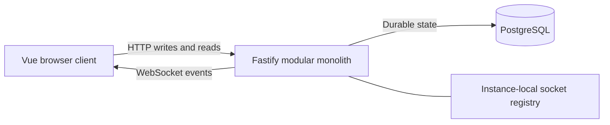

# Architecture

## Original Baseline and Current Design

The original goal was the smallest reliable one-to-one messenger for learning
Node.js and system design. Its core decisions remain current: one Fastify modular
monolith, PostgreSQL as durable truth, HTTP writes, best-effort WebSocket events,
and HTTP history recovery. The Vue application is a separate static deployment,
not a second backend service.

The current implementation adds routing, presentation/effect separation, session
recovery, registration feedback and opt-in abuse controls within those boundaries.
A deployment diagram alone does not justify Redis or additional services.

## Backend Responsibilities

| Boundary                                           | Responsibility                                                                                         |
| -------------------------------------------------- | ------------------------------------------------------------------------------------------------------ |
| `src/app.ts`, `src/server.ts`, `src/config/env.ts` | Compose plugins/routes, validate environment, listen and close the application.                        |
| `src/modules/auth/`, `src/plugins/auth.ts`         | Registration policy, Argon2id hashing, login and JWT verification.                                     |
| `src/modules/conversations/`                       | Resolve participants, enforce canonical direct pairs and list memberships.                             |
| `src/modules/messages/`                            | Validate requests/membership, persist idempotently, publish after persistence and read cursor history. |
| `src/plugins/postgres.ts`                          | Own the PostgreSQL pool and close it with the app.                                                     |
| `src/plugins/realtime.ts`, `src/modules/realtime/` | Own sockets, authenticate admission, enforce optional occupancy and deliver events.                    |
| `src/limits/`, `src/plugins/http-write-limit.ts`   | Application-owned fixed windows and authenticated write admission before database work.                |

Route-local SQL and validation keep the current small modules understandable.
There is no demonstrated need for a generic repository/service layer. A new
abstraction should remove concrete duplicated responsibility, not merely wrap a
query. Fastify plugin encapsulation and application-scoped resources remain the
composition mechanism.

The schema contains `users`, `conversations`, `direct_conversations`,
`conversation_members` and `messages`. Ordered unique user pairs prevent duplicate
direct conversations. Memberships use a composite key; messages have
`UNIQUE(sender_id, client_message_id)` and a chronological conversation index.
Migrations are explicit release steps, not application-start side effects.

## Message Write and Recovery

1. Verify JWT, apply the enabled user quota, validate payload and check membership.
2. Persist the message. An unchanged sender/client ID returns the original row.
3. For a new row, attempt `message.created` fan-out to connected members. Delivery
   failure does not undo persistence; a retry does not publish a duplicate event.
4. Return the stored message through HTTP. HTTP responses and socket events can
   arrive in either order; the client merges by message ID.

Latest/earlier history and forward recovery use `(created_at, id)` cursor order.
PostgreSQL microseconds are retained in response timestamps. Recovery advances
from the HTTP history cursor, not the latest realtime-rendered message, so an
out-of-order event cannot cause an intervening persisted message to be skipped.

The browser starts its recovery callback on WebSocket `open`, not on
`connection.accepted`. A subsequently rejected socket can briefly look connected
and trigger HTTP recovery. This is an accepted limitation; see the
[contracts](api-contracts.md) and [abuse controls](api-abuse-protection.md).

## Frontend Ownership

`DashboardView.vue` is the feature composition root. It connects these owners,
wires incoming events to message/discovery handlers, and disposes them on exit:

| Owner                                                   | Responsibility                                                                                                           |
| ------------------------------------------------------- | ------------------------------------------------------------------------------------------------------------------------ |
| `auth/session.ts`, `router.ts`, `DashboardGateView.vue` | Session verification and protected-route gating; recover transient verification failures without exposing the dashboard. |
| `auth/login.ts`, `auth/registration.ts`                 | Form values, feedback and single pending authentication submission.                                                      |
| `useConversations.ts`                                   | Contact list, creation feedback and grouped refresh/discovery requests.                                                  |
| `useConversationRoute.ts`                               | Read-only selected ID derived from URL and the loaded list, URL corrections and navigation intent.                       |
| `useConversationMessages.ts`                            | Current draft/send state, history cursors, ID deduplication and recovery.                                                |
| `useTranscriptScroll.ts`                                | DOM geometry and post-render restoration/follow behavior.                                                                |
| `useConversationAnnouncements.ts`                       | Source-aware incoming-message and connection announcements, batching and timer cleanup.                                  |
| `realtime.ts`                                           | One active dashboard socket, current-socket callback guards, automatic reconnect and manual capacity recovery.           |

Typed update effects join message state to scroll/announcement behavior without
putting DOM measurement into data state. Initial/local sends reveal the end;
earlier pages preserve the reading anchor; realtime/recovery follow only near
the end. Incoming announcements exclude own messages, initial/earlier history and
already-known IDs.

Components under `components/conversations/` render controlled data and emit
intents. Local presentation state, such as the expandable Start a conversation
form, stays with its component. It does not create a competing selected-ID or
message store. The right participant panel contains decorative avatar/email
information, not a profile/settings model.

Session and transport singletons assume one active dashboard per browser page;
each tab is independent. Disposal invalidates pending callbacks and closes the
owned socket. Request versions prevent late responses/effects from changing a
new selection. They do not cancel server-side work or preserve per-conversation
drafts: switching conversations currently clears draft/retry state (pending #58).

## Security and Operational Boundaries

JWTs expire after 15 minutes. The MVP stores them in browser local storage;
`/auth/me` verifies and returns claims, not a live profile or email-ownership check.
There is no token revocation/refresh or account-management flow. WebSocket JWTs
are checked at connection admission; established sockets do not revalidate expiry.
The client currently also retries `1008` policy closes automatically.

The always-active body limit and default-off HTTP/WebSocket controls are
implemented. Their thresholds, failure contracts, local-state limitations and
owner activation procedure live in [API abuse protection](api-abuse-protection.md).
Trustworthy forwarded-IP extraction and auth/email request quotas remain deferred.
CORS restricts browser origins; it is not authorization or abuse prevention.

## Evolution Boundaries

The current architecture has no Redis, queues, workers, presence, groups,
attachments, push notifications, search or end-to-end encryption. Cross-instance
fan-out requires a demonstrated multi-instance need (#17); it would not make
local quotas or socket occupancy globally enforced. Add infrastructure only
for an approved requirement, with explicit failure/recovery behavior.

For exact payloads and current UI limitations, use [API and client contracts](api-contracts.md).
For local workflow and hosting operations, use [development](../development/setup.md)
and [production deployment](../deployment/production.md).
